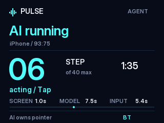

# Live agent progress and screen-wait measurements — build 15

Validated on 2026-10-23 with source c2ea2fd, PULSE 1.1 (15), the ESP32-S3
N8R8/ST7789 board, and the physical iPhone running iOS 27.0.

## Delivered behavior

During an AI run, the TFT automatically shows the agent page with a large round
number, maximum rounds, elapsed time, current phase/action, and the previous
round's screen/model/input timings. A small animated indicator distinguishes
an active run. It shows completion, failure, or stopped status briefly before
returning to the normal pages. An active run whose telemetry has not arrived
for eight seconds shows **App link lost**.

The displayed step is one model decision round. A round can issue multiple
taps; it is not a percentage-complete estimate or a count of individual taps.
Model waiting/retry is distinguished from input execution.

This authenticated framebuffer capture came from the physical board during
the successful run, showing round 6 while the agent was sending a tap:

The app sends bounded telemetry over its existing BLE log channel on transitions
and a best-effort one-second heartbeat. Busy transport can drop a record; the
heartbeat refreshes it. It contains no task text, typed content, model reply,
or credentials. Firmware uses fixed-size fields and rejects malformed values,
older runs, and active updates after a terminal run. The authenticated status
API exposes the same state in its agent object.

## Speed change

Continuous AirPlay transport updates previously reset the generic quiet timer
even when the picture was unchanged. Local Wi-Fi video now compares a 48 × 96
luminance sample, excludes the top status-bar region, and waits for visual quiet.
Small changes accumulate against the last changed image.

The post-action path checks for a fresh capture first and avoids consecutive
generic settling windows. It retains a bounded pointer probe, a recent board
watermark check, and the requirement for a capture after the action. Missing
or broken video still stops the run. Calibrated pointer movement timing was
not shortened.

| Measurement | Before: build 14 | After: build 15 |
| --- | --- | --- |
| Captured nonterminal round samples | 3 | 9 |
| Median screen-wait time | 4,045 ms | 1,052 ms |
| Mean screen-wait time | 4,085 ms | 1,187 ms |
| Range | 4,015–4,195 ms | 570–2,403 ms |

The median screen wait decreased by **74.0%** in these observations. The baseline
is three samples from an earlier 23 + 19 Calculator run; the newer samples are
the complete nonterminal rounds of the 37 + 28 run below. These are small,
sequential observations with different transitions, not a controlled benchmark
or a claim of 74% faster end-to-end execution.

| Build 15 round | Screen wait (ms) | Model (ms) | Input (ms) |
| --- | ---: | ---: | ---: |
| 1 | 2,403 | 16,740 | 2,829 |
| 2 | 1,100 | 4,970 | 537 |
| 3 | 1,587 | 5,850 | 937 |
| 4 | 570 | 6,900 | 0 |
| 5 | 952 | 7,460 | 5,358 |
| 6 | 925 | 7,440 | 6,831 |
| 7 | 1,052 | 9,050 | 581 |
| 8 | 1,029 | 7,820 | 535 |
| 9 | 1,061 | 8,170 | 7,582 |
| 10: completed | 0 | 5,070 | 0 |

Round 4 was an intentional wait, with no input. Round 10 only verified completion
and is excluded from screen-wait statistics. The model column excludes initial
planning. App logs round to integer milliseconds; TFT telemetry truncates them.

## Physical run and failure coverage

The first build 15 run, 20261023-193627, failed after repeated model timeouts
near 30 seconds. The TFT showed waiting/retry, terminal telemetry reported
failed / Run_error, and input was released. Its one completed post-action
screen wait was 3,238 ms. This run did not complete Calculator.

The retry, 20261023-194730, completed the following path:

1. Start the installed agent through its existing UART-to-app development command,
   using the same run service as Start. The preceding run exercised the actual
   Start button.
2. AirPlay capture on ESP32 → local Wi-Fi video → app software decoder → configured
   claude-sonnet-5-5 model → ESP32 Bluetooth HID.
3. Open Calculator through Spotlight and enter 37 + 28 using visible keys.
4. Independently read Calculator's accessibility tree: previous expression
   37 + 28, result 65. Its screenshot confirmed this. iCTRL observed the run;
   it did not enter the expression or perform the calculation.
5. Agent terminal state done / Completed, round 10. Firmware reported running=false,
   releasing=false, output CPS 0, Bluetooth mouse connected, and empty last error.
   The input-release command succeeded.

The run took **142.2 seconds** from the run service's start to its finish log.
Startup took 15.1 seconds, including 13.5 seconds before video readiness. The ten
actor responses had a median of 7.45 seconds and totalled 79.47 seconds, plus
a 6.5-second initial planner request. Model response time remains the largest
delay. Some actions were repeated or corrected before success; this does not
establish reliable navigation across arbitrary apps.

A temporary HTTP 503 while awaiting a new video IDR recovered during the successful
run. Screen freshness was still checked. Stream logs reported zero decoded frame
drops. Synthetic UART telemetry on real firmware separately verified round/action
rendering and the stale-link warning.

Control Center independently showed **行動數據: 關閉** after testing. The model
and local-video sessions also prohibit cellular access. Five saved profiles and
selection [3] remained intact.

## Build, tests, installation, and recovery

One [Actions run, 39945021051](https://github.com/Rayray1099/esp32-iphone-agent/actions/runs/39945021051),
passed **107 unit tests and 5 UI tests** with zero failures and built the device
IPA. No extra Actions run was used for installation or hardware validation.
Local C++ host tests passed for scheduler behavior, transfer/integrity, OTA
validation, telemetry bounds/ordering/staleness, and rendered TFT fixtures.
Swift frontend parsing and the ESP-IDF firmware build also passed.

The original CI IPA was installed through LCSign over the existing app. The
app's update screen confirmed **1.1 (15)**. Bundle and signing identity were
preserved; the IPA was not repacked locally.

| Artifact | Size (bytes) | SHA-256 |
| --- | ---: | --- |
| Original unsigned IPA | 5,214,597 | be3ad682d7dca251bf69fc627202e9c3f7f8cdac7c7167e6c732b5989c6307a4 |
| Flashed application | 1,811,248 | 4e6c9c02960fa6558ba06adf0057a79a1c6c9ab9edf237ae66e9857f364b5924 |
| Previous application readback | 1,808,464 | 718ac7a77e5c277fb07545ab11956ad3ccaf5e69ebc167cc5a80e415f3d249cf |

The application was flashed at 0x20000 on COM3 with hash verification. Bootloader,
partition table, profiles, and settings were preserved. The first backup read at
921600 baud failed with corrupt serial data; repeating at 460800 succeeded and
matched the previous application. No erase was performed. This work installed
build 15 locally; it did not publish a replacement release.

Local evidence remains in ignored output/agent-20261023/: installed-version
and phone screenshots, before/after timing JSON, final status/profile JSON,
original IPA, firmware/build/flash logs, previous-application readback, and UART
captures. The successful timings are recoverable from uart-1792756257930647400.log
and uart-1792756342624658600.log. Raw phone screenshots and logs are not committed
because they may contain personal UI content. The committed board capture
contains only bounded run telemetry.

This task does not revalidate CPS limits, eduroam login, Tailscale fallback,
or OTA rollback. Faster screen settling is separate from faster click output.
